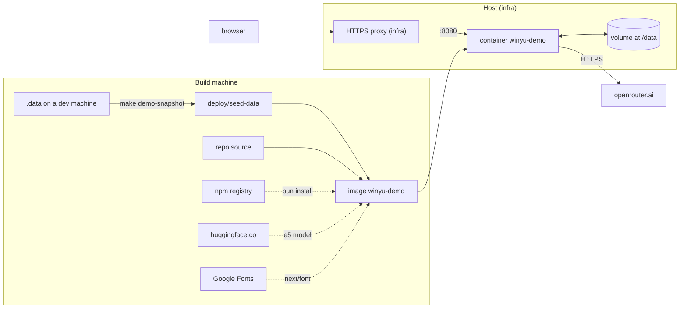

# Deploying the Winyu demo

This document is for the person who runs the Winyu demo container. It covers what the image holds, how its parts connect, what it needs from the host, and how to build, start, update, and reset it. The decisions behind this setup are in `docs/plans/demo-deploy.md`.

The demo deploys to the team's GKE cluster through GitLab CI, the same way as `sol-backoffice-ui` and `sol-storefront-api` (see [Deploy on the team's GKE](#deploy-on-the-teams-gke)). The Docker and `make` commands under [Run locally with Docker](#run-locally-with-docker) are for a laptop. Facts we do not know yet are listed under [For infra to fill in](#for-infra-to-fill-in). The handoff to the infra team, in Thai, is `docs/handoff-infra.md`.

## What runs

Winyu is one Next.js server process in one container. Nothing else runs beside it. The same process does all of the following:

- It serves the web app and the API on port `8080` in the container. `deploy/compose.yaml` publishes it on `localhost:3100`.
- It runs the chat agent (Mastra) and calls the model through OpenRouter.
- It runs the background jobs on Bangkok cron when `WINYU_SCHEDULER=on`: anomaly and forecast at midnight, watches hourly, and the digest at 07:00.
- It embeds memory text with a local model (`Xenova/multilingual-e5-base`), which ships inside the image.
- It finishes any chat run that a restart cut off. It does this on boot.

There is no database server, no cache, and no queue. All state is files in `/data`.



Dashed lines happen only at build time. At run time the container talks to `openrouter.ai` and nothing else.

## Image contents

`Dockerfile` has two stages.

| Stage | Base | What it does |
|---|---|---|
| `build` | `node:22-bookworm`, with the `bun` binary copied from `oven/bun:1.4-debian` | `bun install --frozen-lockfile` from `bun.lock`, `bun run scripts/warm-embedder.ts` to download the e5 model (282 MB), `next build` |
| runtime | `node:22-bookworm-slim` | Runs as user `node`. Holds `node_modules`, `.next`, `public`, the model cache in `/home/node/.cache/winyu/models`, the snapshot in `/app/seed-data`, and `entrypoint.sh` |

Bun is in the build stage only. The runtime image has Node and no Bun. The runtime base is Debian, not Alpine, because `onnxruntime-node` needs glibc.

The image sets `NODE_ENV=production`, `WINYU_DATA_DIR=/data`, and `PORT=8080`. It declares `VOLUME /data`, `EXPOSE 8080`, and a health check that fetches `/login` every 30 seconds.

## Startup

`deploy/entrypoint.sh` runs on every start:

1. If `/data` is empty, it copies `/app/seed-data` into `/data` and logs `entrypoint: seeded /data from the demo snapshot`.
2. It starts `next start --hostname 0.0.0.0 --port 8080`.

A volume that already holds data is never overwritten. A new image therefore keeps the existing demo state. To start again from the snapshot in the image, reset the volume (see [Reset the demo data](#reset-the-demo-data)).

## Data in `/data`

| Path | Holds |
|---|---|
| `*.json` | JSON collections: alerts, threads, approvals, audit, dashboards, packets, notifications, the model-call ledger, admin switches, and role overrides |
| `mastra.db` | LibSQL file: chat threads and messages, durable runs, Mastra traces, and the `winyu_recall` memory vectors |
| `secrets.json` | The session signing key the server generates for itself. Written only when `WINYU_SESSION_SECRET` is unset |

Run one container per volume. Two containers on the same volume corrupt the JSON files and `mastra.db`, because the app assumes it is the only writer. The app does not scale horizontally.

Back up the volume by stopping the container and copying the directory. `mastra.db` runs in WAL mode, so a copy taken while the container runs can be inconsistent.

## Environment

`deploy/.env.example` lists the variables the demo uses. Copy it to `deploy/.env` and fill in the secrets. `deploy/.env` is in `.gitignore`.

| Variable | Required | Demo value | Effect |
|---|---|---|---|
| `OPENROUTER_API_KEY` | yes | a key that has a credit limit | Every model call. Without it, chat and jobs fail |
| `WINYU_SESSION_SECRET` | yes | 32 or more random characters | Signs session cookies. A change signs everyone out |
| `WINYU_AUTH` | yes | `demo` | The persona picker. When unset in production, the app expects Microsoft Entra and the picker is off |
| `AGENT_MODEL` | no | `google/gemini-3.8-flash` | The OpenRouter model the agent and the jobs call. Unset means Gemini 3.8 Flash |
| `WINYU_SCHEDULER` | no | `on` | `off` stops the background jobs |
| `WINYU_CONNECTOR_HOSTS` | no | empty | Hosts an admin may point an MCP connector at. Empty refuses every host |
| `WINYU_CONNECTOR_KEY` | no | unset | Seals the secrets of console connectors. Needed only when an admin adds a connector that has a secret |
| `INVESTIGATE_DAILY` | no | unset | `1` runs the morning investigation for every person at 06:00, about 7 model calls each |
| `WINYU_OTEL_ENDPOINT` | no | unset | Also exports traces to this OTLP/HTTP URL. Traces carry prompts and tool results |

The demo does not use the `ENTRA_*`, `LINE_*`, `TEAMS_*`, or `WINYU_PUBLIC_URL` variables. `docs/sso.md` and `docs/channels.md` describe them.

## Network

- **Inbound.** Port `8080`, plain HTTP. Put an HTTPS proxy or load balancer in front of the container. In production the session cookie is `Secure`. If the browser reaches the app over plain HTTP, sign-in fails and shows no error.
- **Outbound at run time.** `openrouter.ai` on port 443.
- **Outbound at build time.** The npm registry for `bun install`, `huggingface.co` for the e5 model, and Google Fonts for `next/font`.

## Exposure

The demo is public. Anyone who opens the URL can pick any of the 26 personas, IT admin included, and spend model credit with our key. Keep these limits in place:

- Give the demo its own OpenRouter key and set a credit limit on that key. The app has no per-visitor limit.
- Leave `WINYU_CONNECTOR_HOSTS` empty, so that the IT admin persona cannot point a connector at any host.
- Reset the data on a schedule. Visitors who pick the same persona share its threads, memory, and dashboard.

## Build machine

Measured on 2026-10-15 and 2026-10-16 in a Docker Desktop VM with 4 GB of memory:

| Builder | Result |
|---|---|
| `docker build` (BuildKit) | Passed once on 2026-10-15. Killed three times on 2026-10-16 in the TypeScript step of `next build`, with the same code |
| Kaniko (`gcr.io/kaniko-project/executor:debug`, the builder CI uses) | Killed during `next build`, also with `--compressed-caching=false --snapshot-mode=redo` |

Kaniko builds inside one container and keeps its own filesystem snapshots in memory on top of `next build`. A local `docker build` needs Docker Desktop set above 4 GB, for example 6 GB. Give the CI build at least 6 GB. That number is an estimate, not a measurement, because only 4 GB was available here. The image is about 4.8 GB, because it carries the full `node_modules` and the 282 MB e5 model.

Most routes do not load the agent. `lib/server/light-requests.test.ts` fails when a session-only path, such as `lib/server/session.ts` or `app/api/feed/route.ts`, statically imports Mastra, the AI SDK, OpenRouter, or OpenTelemetry. If that test fails, the build needs more memory again.

## Deploy on the team's GKE

These files follow the pattern of the team's other services:

| File | Role |
|---|---|
| `.gitlab-ci.yml` | Off until the CI variable `WINYU_DEPLOY_ENABLED` is `"true"` (`docs/adr/0004-gated-gitlab-pipeline.md`). Then, on a push to `uat`: Kaniko builds the image and pushes it to `asia-southeast1-docker.pkg.dev/singhaonline-dev/sol/winyu:uat`, `envsubst` fills `k8s-deploy.yml`, then `kubectl apply`, `kubectl rollout restart`, and `kubectl rollout status` in namespace `sol-uat` on `singhaonline-dev-cluster` |
| `k8s-deploy.yml` | A Deployment and a Service. CI fills `${CI_PROJECT_NAME}` (the GitLab project, `winyu`) and `${DOCKER_IMAGE_URL}` |
| `deploy/k8s-config.example.yml` | The ConfigMap `winyu-config` and the Secret `winyu-secret`. Infra creates them once per namespace, with real values |
| `deploy/k8s-nightly-reset.yml` | Optional. A CronJob that restarts the Deployment at 03:00 Bangkok time, with the ServiceAccount and Role it needs. Infra applies it once |

The Deployment differs from the Go services in these ways:

- **`replicas: 1`, always.** The state lives in the pod. Two pods would each hold different chats and dashboards.
- **`/data` is an `emptyDir` (1 Gi).** Every new pod starts empty, so the entrypoint copies the snapshot in. A deploy, a `rollout restart`, a crash, or a node upgrade therefore resets the demo data. The nightly CronJob uses this to reset the demo.
- **Config comes from `envFrom`.** The app reads environment variables, not an `application.yml` file. `winyu-config` holds the plain settings and `winyu-secret` holds `OPENROUTER_API_KEY` and `WINYU_SESSION_SECRET`.
- **Resources.** Requests `1Gi` memory and `250m` CPU, limit `2Gi` memory. Measured in Docker: 425 MiB idle and 541 MiB after every page for three personas. The e5 embedder loads after the first chat. We estimate that it brings the pod to about 1 GB.
- **Probes on `GET /login`.** The app has no `/healthz`. A startup probe allows 2 minutes for the first start.
- **Port.** The container listens on `8080`, and the Service exposes `8080`, the same port as the `sol-*` services.

The snapshot `deploy/seed-data` is committed to git, because CI builds from the repository. Take a new snapshot with `make demo-snapshot` and commit it when the demo data should change.

### First deploy

1. Make a runner with about 6 GB for Kaniko available to the project `gitlab.com/sbpds-ai/winyu`.
2. Set the CI variable `UAT_SERVICE_ACCOUNT64` on the project, the same as on the other `sol-*` projects.
3. Fill in `deploy/k8s-config.example.yml`. Do not commit the real values. Then run `kubectl apply -f <the filled file> -n sol-uat`.
4. Set the CI variable `WINYU_DEPLOY_ENABLED` to `true`, then merge `main` into `uat`. The pipeline builds, applies, and waits for the rollout.
5. Point an ingress with TLS at the Service `winyu`, port 8080.
6. Optional: run `kubectl apply -f deploy/k8s-nightly-reset.yml -n sol-uat`.
7. Open the URL, pick a persona, and ask one question (see [Check that it runs](#check-that-it-runs)).

## For infra to fill in

We do not know these facts. Fill them in here when you know them, and change the files they point at.

| Question | What we assumed | Where it is set | Answer |
|---|---|---|---|
| Can a project in the `sbpds-ai` group use the `gcloud-sol-dev` runner? | Yes | GitLab runner settings, `.gitlab-ci.yml` `tags` | |
| How much memory does that runner give a Kaniko job? The build needs about 6 GB (estimate). | Enough | `.gitlab-ci.yml` `tags` | |
| Which namespace hosts the demo? | `sol-uat` | `.gitlab-ci.yml` `UAT_NAMESPACE` | |
| Which registry path and tag? | `singhaonline-dev/sol/winyu:uat` | `.gitlab-ci.yml` `UAT_DOCKER_IMAGE_URL` | |
| Can `UAT_SERVICE_ACCOUNT64` push to that path and deploy to that namespace? | Yes, as for the `sol-*` projects | GitLab CI variables | |
| What is the public hostname, and who issues its TLS certificate? | Infra's ingress | Outside this repository | |
| Can pods in the namespace reach `openrouter.ai:443`? | Yes | Cluster egress or NAT | |
| Can the runner reach the npm registry, `huggingface.co`, and Google Fonts during the build? | Yes | Runner network | |
| Do nodes labelled `sol: "true"` have 2 GiB of free memory for this pod? | Yes | `k8s-deploy.yml` `nodeSelector` | |
| May the cluster pull `bitnami/kubectl:1.31` from Docker Hub for the nightly reset? | Yes | `deploy/k8s-nightly-reset.yml` | |
| Who holds the OpenRouter key, and what is its credit limit? | A demo-only key with a limit | Secret `winyu-secret` | |
| Is a `uat` branch the right trigger, or does the demo need its own branch? | `uat` | `.gitlab-ci.yml` `workflow` and `only` | |

## Run locally with Docker

The `Makefile` targets wrap `docker compose -f deploy/compose.yaml`. `deploy/compose.yaml` defines one service, `app`, with image `winyu-demo`, port `3100:8080`, volume `winyu-data:/data`, and `env_file: .env`. Infra can use the compose file as is or take only the image.

| Command | Does |
|---|---|
| `make demo-snapshot` | Copies the dev `.data` into `deploy/seed-data` (`scripts/deploy-snapshot.ts`) |
| `make demo-build` | Runs `demo-snapshot`, then builds the image `winyu-demo` |
| `make demo-start` | Starts the container |
| `make demo-stop` | Stops the container |
| `make demo-logs` | Follows the container log |
| `make demo-reset` | Empties the volume and starts again from the snapshot (`deploy/reset-demo.sh`) |

### Build the image

1. On a dev machine with the demo state you want, run `make demo-snapshot`.
2. Check that `deploy/seed-data` holds `mastra.db` and has no `secrets.json`.
3. Run `make demo-build`.
4. To ship the new snapshot to GKE, commit `deploy/seed-data` on `main` and merge `main` into `uat`.

The snapshot step reads `.data` and never changes it. In the copy it removes the following:

- `secrets.json`
- every MCP connector added from the admin console, and its secrets, upstream state, health row, and switch
- every admin-issued MCP token

The step also checks the copied `mastra.db` with `pragma integrity_check`.

### Run the image without compose

```bash
docker run -d --name winyu-demo \
	-p 3100:8080 \
	--env-file deploy/.env \
	-v winyu-data:/data \
	--restart unless-stopped \
	winyu-demo
```

### Check that it runs

1. Wait for `docker inspect --format '{{.State.Health.Status}}' winyu-demo` to print `healthy`.
2. Open the HTTPS URL. The persona picker loads.
3. Pick a persona. The landing page shows that persona's greeting and cards.
4. Ask the chat one question. An answer arrives with a card. One question costs about $0.006.

### Update to a new image

1. Build the new image.
2. Run `make demo-stop`, then `make demo-start`. The volume keeps its data.

To also replace the data with the new image's snapshot, run `make demo-reset` after the start.

### Reset the demo data

`make demo-reset` stops the container, deletes everything in the volume, and starts the container again. The entrypoint then copies the snapshot in. To reset every night, run `deploy/reset-demo.sh` from host cron, for example at 03:00 Bangkok time.

## Logs

The server logs to stdout. Lines that start with `[Winyu]` come from the app: connector reconcile, the analytics plane fill, and chat-run recovery after a restart.
