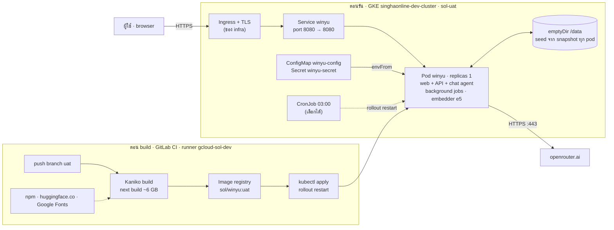

# Winyu demo: handoff ให้ทีม Infra

16 ต.ค. 2569

## สรุป

Winyu demo พร้อม deploy ขึ้น `singhaonline-dev-cluster` เป็น pod เดียว ผ่าน GitLab CI แบบเดียวกับ `sol-backoffice-ui` และ `sol-storefront-api` ไฟล์ทั้งหมดอยู่ใน repo [`gitlab.com/sbpds-ai/winyu`](https://gitlab.com/sbpds-ai/winyu) branch `main`

Winyu คือ AI copilot ที่ตอบคำถามด้วยการ์ดข้อมูล ข้อมูลใน demo เป็นของสมมติทั้งหมด เปิดสาธารณะ ผู้เยี่ยมชมเลือก persona เข้าใช้ได้โดยไม่ต้องมีรหัสผ่าน

ขอให้ทีม infra ช่วย 5 อย่าง:

1. เปิด runner ให้ project `sbpds-ai/winyu` ใช้ได้ และตั้ง CI variable `UAT_SERVICE_ACCOUNT64`
2. สร้าง ConfigMap `winyu-config` และ Secret `winyu-secret` ใน namespace ที่เลือก
3. ตั้ง ingress พร้อม TLS ชี้ไปที่ Service `winyu` port 8080
4. ให้ Kaniko job บน runner `gcloud-sol-dev` มี memory ประมาณ 6 GB (เป็นตัวเลขประมาณ ดู [สิ่งที่ทดสอบแล้ว](#สิ่งที่ทดสอบแล้ว))
5. ตอบคำถามใน [คำถามที่ต้องให้ infra ตอบ](#คำถามที่ต้องให้-infra-ตอบ) แล้วตั้ง `WINYU_DEPLOY_ENABLED=true` เพื่อเปิด pipeline

สถานะ: pipeline ยังปิดอยู่ GitLab จะไม่สร้าง pipeline จนกว่าจะตั้ง CI variable `WINYU_DEPLOY_ENABLED=true` และ push เข้า `uat` (ดู `docs/adr/0004-gated-gitlab-pipeline.md`) image build และทดสอบใน Docker บนเครื่อง dev ผ่านแล้วทุก role แต่ build ด้วย Kaniko ยังไม่ผ่านบนเครื่องที่มี memory 4 GB รายละเอียดเชิงเทคนิคทั้งหมดอยู่ใน [`docs/deploy.md`](deploy.md)

## ของที่ส่งมอบ

ทุกไฟล์อยู่ใน repo `sbpds-ai/winyu`

| ไฟล์ | หน้าที่ | ใครใช้ |
| --- | --- | --- |
| `.gitlab-ci.yml` | เมื่อ `WINYU_DEPLOY_ENABLED=true` และ push เข้า `uat` → Kaniko build → push ไป `asia-southeast1-docker.pkg.dev/singhaonline-dev/sol/winyu:uat` → `kubectl apply` และ `rollout restart` ใน `sol-uat` แล้วรอ `rollout status` | CI |
| `Dockerfile` | build stage: `node:22-bookworm` + bun (install, โหลด model e5) · runtime: `node:22-bookworm-slim` รันเป็น user `node` | CI |
| `k8s-deploy.yml` | Deployment + Service ที่ CI เติม `${CI_PROJECT_NAME}` และ `${DOCKER_IMAGE_URL}` | CI |
| `deploy/k8s-config.example.yml` | แม่แบบ ConfigMap `winyu-config` + Secret `winyu-secret` | infra เติมค่าจริงแล้ว apply ครั้งเดียว (ห้าม commit ค่าจริง) |
| `deploy/k8s-nightly-reset.yml` | CronJob สั่ง `rollout restart` ตี 3 เวลาไทย พร้อม ServiceAccount และ Role ที่ patch ได้เฉพาะ deployment `winyu` | infra เลือกจะ apply หรือไม่ก็ได้ |
| `deploy/seed-data/` | snapshot ข้อมูล demo 33 MB (JSON + `mastra.db`) ที่ฝังเข้า image | ทีม dev อัปเดตด้วย `make demo-snapshot` |
| `docs/deploy.md` | reference เต็ม: ส่วนประกอบ, env, network, คำสั่ง | ทุกคน |
| `deploy/compose.yaml`, `Makefile` (`demo-*`) | รันบนเครื่อง dev ด้วย Docker | ทีม dev |

## ระบบเชื่อมกันอย่างไร

ตอน build เท่านั้นที่ต้องออกเน็ตไป npm, huggingface.co และ Google Fonts ตอนรัน pod ออกไปที่ `openrouter.ai` ที่เดียว ไม่มี database, cache หรือ queue แยก

## ขั้นตอน deploy ครั้งแรก

ทำตามลำดับ แต่ละขั้นเช็กผลก่อนไปขั้นถัดไป

- [ ] เปิด runner `gcloud-sol-dev` (หรือ runner อื่นที่มี memory ประมาณ 6 GB) ให้ project `sbpds-ai/winyu` ใช้ได้
- [ ] ตั้ง CI variable `UAT_SERVICE_ACCOUNT64` ให้เหมือน project `sol-*` อื่น
- [ ] เติมค่าใน `deploy/k8s-config.example.yml` แล้วรัน `kubectl apply -f <ไฟล์ที่เติมแล้ว> -n sol-uat` ตั้ง `WINYU_SESSION_SECRET` ด้วย `openssl rand -hex 32` และใช้ OpenRouter key ที่ตั้งวงเงินไว้
- [ ] ตั้ง CI variable `WINYU_DEPLOY_ENABLED=true` แล้ว merge `main` เข้า `uat` รอ pipeline ครบ 4 job จะจบที่ `rollout status` บอกว่า deployment พร้อม
- [ ] เช็ก log ของ pod ต้องเห็น `entrypoint: seeded /data from the demo snapshot` และ `Ready`
- [ ] ตั้ง ingress พร้อม TLS ชี้ไป Service `winyu` port 8080
- [ ] (เลือกได้) `kubectl apply -f deploy/k8s-nightly-reset.yml -n sol-uat`
- [ ] เปิด URL ผ่าน HTTPS เลือก persona แล้วถาม 1 คำถาม ตาม [วิธีตรวจและดูแล](#วิธีตรวจและดูแล)

## คำถามที่ต้องให้ infra ตอบ

ทีม dev ไม่รู้คำตอบของข้อเหล่านี้ จึงตั้งค่าตามที่สมมติไว้ กรุณาเติมคำตอบในคอลัมน์สุดท้าย ถ้าคำตอบไม่ตรงกับที่สมมติ ให้แก้ค่าในไฟล์ที่ระบุไว้ด้วย

| # | คำถาม | ที่เราสมมติ | ตั้งค่าที่ | คำตอบจาก infra |
| --- | --- | --- | --- | --- |
| 1 | runner `gcloud-sol-dev` ลงทะเบียนไว้กับ group `singhaonline` ถ้าใช่ จะเปิดให้ project ใน group `sbpds-ai` ใช้ได้ไหม | ใช้ได้ | GitLab runner settings, `.gitlab-ci.yml` `tags` | |
| 1b | runner นั้นให้ memory กับ Kaniko job เท่าไร build นี้ต้องการประมาณ 6 GB | พอ | `.gitlab-ci.yml` `tags` | |
| 2 | demo อยู่ namespace ไหน | `sol-uat` | `.gitlab-ci.yml` `UAT_NAMESPACE` | |
| 3 | registry path และ tag | `singhaonline-dev/sol/winyu:uat` | `.gitlab-ci.yml` `UAT_DOCKER_IMAGE_URL` | |
| 4 | service account ของ `UAT_SERVICE_ACCOUNT64` push path นั้นและ deploy เข้า namespace นั้นได้ไหม | ได้ เหมือน `sol-*` | GitLab CI variables | |
| 5 | hostname สาธารณะคืออะไร และใครออก TLS certificate | ingress ของ infra | นอก repo | |
| 6 | pod ออกไป `openrouter.ai:443` ได้ไหม | ได้ | egress หรือ NAT ของ cluster | |
| 7 | runner ออกไป npm registry, `huggingface.co` และ Google Fonts ตอน build ได้ไหม | ได้ | network ของ runner | |
| 8 | node ที่ติด label `sol: "true"` มี memory ว่าง 2 GiB สำหรับ pod นี้ไหม | มี | `k8s-deploy.yml` `nodeSelector` | |
| 9 | cluster ดึง image `bitnami/kubectl:1.31` จาก Docker Hub ได้ไหม (ใช้ใน reset รายคืน) | ได้ | `deploy/k8s-nightly-reset.yml` | |
| 10 | ใครถือ OpenRouter key ของ demo และตั้งวงเงินเท่าไร | key แยกที่มีวงเงิน | Secret `winyu-secret` | |
| 11 | ใช้ branch `uat` เป็นตัว trigger หรือ demo ควรมี branch ของตัวเอง | `uat` | `.gitlab-ci.yml` `workflow` และ `only` | |
| 12 | `sol-backoffice-api` และ `sol-backoffice-ui` มี branch `prd-demouat` ที่ deploy ขึ้น prd cluster ถ้า demo ของทีมอยู่ที่นั่น Winyu demo ควรไปอยู่ด้วยแทน `sol-uat` ไหม ถ้าใช่ ต้องเพิ่ม job ที่ใช้ runner `gcloud-sol-prd` และ registry `singhaonline-prd` แบบเดียวกับ `sol-backoffice-api` | `sol-uat` บน `singhaonline-dev-cluster` | `.gitlab-ci.yml` | |

## ข้อควรระวังที่ต่างจาก service `sol-*`

ข้อห้ามที่สำคัญที่สุดคือ ห้ามเพิ่ม replicas เกิน 1 เพราะ state อยู่ใน pod แต่ละ pod จะมีแชทและ dashboard คนละชุด

| เรื่อง | `sol-*` ทำแบบนี้ | Winyu ทำแบบนี้ | เพราะ |
| --- | --- | --- | --- |
| replicas | prd ใช้ 3 | 1 เสมอ | เก็บข้อมูลเป็นไฟล์ใน `/data` ไม่มี database แยก |
| storage | ไม่มี | `emptyDir` 1 Gi ที่ `/data` | ทุก pod ใหม่เริ่มจาก snapshot ใน image การ deploy, restart, pod ล่ม หรือ node อัปเกรด จึงเท่ากับ reset ข้อมูล demo (ตั้งใจ) |
| config | ConfigMap mount เป็น `application.yml` | `envFrom` จาก ConfigMap + Secret | แอปอ่าน environment variable |
| resources | requests `10Mi` | requests `1Gi` / `250m`, limit `2Gi` | วัดได้ 425 MiB ตอนว่าง และ 541 MiB หลังเปิดหน้าครบ 3 role หลังแชทครั้งแรก embedder จะโหลดเข้ามา คาดว่าราว 1 GB (ประมาณ) |
| probe | `/healthz`, `/readyz` | `GET /login` + startupProbe 2 นาที | แอปยังไม่มี `/healthz` |
| build | Go build เร็ว ใช้ memory น้อย | `next build` ประมาณ 6 GB ใน Kaniko | Next.js + Turbopack ถือ module graph ทั้งหมดไว้ใน memory |
| image | ไม่กี่สิบ MB | ประมาณ 4.8 GB | มี `node_modules` ทั้งหมดและ model e5 282 MB |

เรื่องอื่นที่ต้องรู้:

- **ต้องเป็น HTTPS:** cookie ของ session ใน production เป็น `Secure` ถ้าเข้าผ่าน HTTP ธรรมดาจะ login ไม่ติดและไม่มี error บอก
- **เปิดสาธารณะ:** ใครมี URL ก็เลือก persona ได้ทุกตัว รวม IT admin และเรียก model ด้วย key ของเราได้ ในแอปไม่มี limit ต่อผู้ใช้ เพดานมีแค่วงเงินของ OpenRouter key
- **egress ตอนรัน:** ออกไปที่ `openrouter.ai` เท่านั้น `WINYU_CONNECTOR_HOSTS` ตั้งว่างไว้ ทำให้ persona IT admin เพิ่ม connector ไปหา host ใดๆ ไม่ได้
- **background job:** รันอยู่ใน pod เดียวกันตาม cron เวลาไทย (เที่ยงคืน, ทุกชั่วโมง, 07:00) ไม่ต้องตั้ง CronJob แยก

## วิธีตรวจและดูแล

**ตรวจว่าใช้งานได้**

1. `kubectl rollout status deployment/winyu -n sol-uat` ต้องจบด้วย `successfully rolled out`
2. เปิด URL ผ่าน HTTPS ต้องเห็นหน้า "วันนี้เข้าใช้ในฐานะใคร" พร้อมรายการ role
3. เลือก พนักงานขาย → คุณกฤต ต้องเข้าหน้าหลักที่มีคำทักทายและการ์ดตัวเลข
4. ถาม "เอเย่นต์ไหนในเขตผมยอดตกมากที่สุดเดือนนี้" ต้องได้การ์ดของขอนแก่น 2 เอเย่นต์ ภายในประมาณ 20 วินาที คำถามนี้ใช้เงินประมาณ $0.006

ถ้าข้อ 2 ผ่านแต่ข้อ 3 เด้งกลับมาหน้า login ให้เช็กว่าเข้าผ่าน HTTPS จริง ถ้าข้อ 4 ไม่ตอบ ให้เช็ก `OPENROUTER_API_KEY` และ egress ไป `openrouter.ai`

**ดูแล**

| งาน | ทำอย่างไร |
| --- | --- |
| ดู log | `kubectl logs deploy/winyu -n sol-uat -f` บรรทัดที่ขึ้นต้นด้วย `[Winyu]` มาจากแอป |
| อัปเดตโค้ดหรือข้อมูล demo | ทีม dev merge `main` เข้า `uat` แล้ว pipeline ทำต่อเอง ข้อมูลจะกลับไปเป็น snapshot ใหม่ |
| reset ข้อมูล demo ทันที | `kubectl rollout restart deployment/winyu -n sol-uat` |
| reset ทุกคืน | CronJob `winyu-nightly-reset` ตอนตี 3 เวลาไทย |
| rollback | tag `uat` ถูกเขียนทับทุกครั้ง จึงใช้ `kubectl rollout undo` ไม่ได้ ให้ revert commit แล้ว push `uat` ใหม่ หรือชี้ deployment ไปที่ digest ก่อนหน้าใน Artifact Registry |
| ปิด demo ชั่วคราว | `kubectl scale deployment/winyu --replicas=0 -n sol-uat` (เปิดกลับด้วย `--replicas=1` เท่านั้น) |

## สิ่งที่ทดสอบแล้ว

ทดสอบเมื่อ 16 ต.ค. 2569 บนเครื่อง dev (Docker Desktop, memory 4 GB, Apple Silicon)

| ทดสอบ | ผล |
| --- | --- |
| `docker build` (BuildKit) | ผ่าน 1 ครั้งเมื่อ 15 ต.ค. แต่ถูก kill 3 ครั้งเมื่อ 16 ต.ค. ตอน `next build` ตรวจ TypeScript ทั้งที่โค้ดเหมือนเดิม 4 GB จึงไม่พอสำหรับการ build |
| Kaniko `executor:debug --no-push` | ไม่ผ่าน ถูก kill ตอน `next build` 2 รอบ รวมรอบที่ใส่ `--compressed-caching=false --snapshot-mode=redo` |
| ตรวจ schema ของ manifest ด้วย kubeconform (Kubernetes 1.31) | ผ่าน 8 resource |
| รัน container บน port 8080 | `/login` ตอบ 200 และคำสั่ง HEALTHCHECK exit 0 |
| เปิด container ด้วย `/data` ว่าง | healthy, seed snapshot ลง `/data` |
| ใช้งานผ่าน browser 3 role | พนักงานขายเห็นเฉพาะเขตตัวเอง · CEO เห็นครบ 6 ภาค · IT admin เปิด Admin console ได้ ไม่มี error ใน console |
| embedder e5 บน Linux | บันทึก memory vector ได้ (`winyu_recall` +2 แถวหลังแชท 1 ครั้ง) |
| restart container | ไม่ seed ทับ แชทยังอยู่ (ทดสอบด้วย Docker volume บน GKE ที่ใช้ `emptyDir` จะเริ่มจาก snapshot ใหม่ทุก pod) |
| memory ตอนรัน | 425 MiB ตอนว่าง, 541 MiB หลังเปิดหน้าครบ 3 role |
| ค่า model ตอนทดสอบ | 6 call รวม $0.017 |

ยังไม่ได้ทดสอบ:

- pipeline จริงบน GitLab และ Kaniko บน runner `gcloud-sol-dev`
- pod บน GKE, probe, ingress และ HTTPS
- CronJob reset รายคืน
- memory ตอนรันหลังจาก embedder โหลดแล้ว
